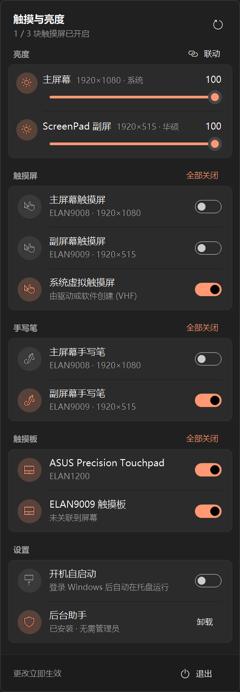

# TouchToggle

[中文](#中文) · [English](#english)

<p align="center"></p>

---

## 中文

一个常驻 Windows 托盘的小工具，可以**逐个开启或关闭**电脑上的触摸屏、手写笔和触摸板，还能**调节每块屏幕的亮度**。特别适合双屏笔记本（如 ASUS ZenBook Duo），可以只关掉某一块屏幕的触摸。

### 功能

- **屏幕亮度**（参考 [Monitorian](https://github.com/emoacht/Monitorian)）：每块屏幕一个滑块，可以拖动，也可以在滑块上滚动鼠标滚轮（每格 2%）。打开“联动”后，调一块屏幕，其他屏幕会按相同幅度一起变化。
  - 笔记本内置屏：Windows 系统亮度接口（WMI）
  - 外接显示器：DDC/CI（需要显示器支持并在显示器菜单中开启）
  - 华硕 ScreenPad 副屏：华硕 ATK 接口，由后台助手代为调节
- **按设备开关**：触摸屏、手写笔、触摸板分组显示，每个设备一个开关；同类有多个时可一键“全部开启 / 全部关闭”。
- **自动识别屏幕**：根据 Windows“平板电脑设置”中的校准信息，标出每个触摸设备对应**主屏幕**还是**副屏幕**及其分辨率。
- **精致的面板**：仿 Windows 快速设置的弹出面板，跟随系统深色 / 浅色模式与强调色，开关带动画，支持高 DPI。
- **托盘图标显示状态**：绿色 = 触摸屏全部开启，橙色 = 部分开启，红色带斜线 = 全部关闭。
- **只需一次管理员授权**：程序本身以普通权限运行，安装时授权一次，之后开关设备不再弹出 UAC。
- **开机自启动**：一键开启，写在当前用户的启动项中，不需要管理员。
- **零依赖**：单个 C# 文件，用 Windows 自带的 .NET Framework 编译器即可构建。

### 系统要求

- Windows 10 2004（版本 19041）或更高版本、Windows 11（需要 `pnputil /enable-device`）
- .NET Framework 4.7.2 或更高（Windows 10 1803 起已内置）

### 安装

1. 从 [Releases](https://github.com/willlllliams/TouchToggle/releases/latest) 下载 `TouchToggle-Setup-<版本>.exe`，双击运行，同意 UAC。
2. 按向导操作：选择语言（简体中文 / English），同意许可协议，选择是否**开机自启动**、是否**创建桌面快捷方式**。
3. 安装程序会把程序装到 `C:\Program Files\TouchToggle\`，在开始菜单创建快捷方式，并注册后台助手。安装完成后可以直接启动。

安装位置固定为 `Program Files`，不能修改。原因是后台助手以 SYSTEM 身份运行安装目录里的程序，这个目录必须只有管理员能写，否则其他程序可以替换它来获取最高权限。

**升级**：直接运行新版安装程序即可。它会自动关闭正在运行的旧版本，并保留你的设置。

### 使用

1. 安装后，任务栏右下角会出现图标。
2. **左键**点击图标打开面板；**右键**有“打开面板 / 退出”。
3. 直接点击开关或拖动亮度滑块即可，不会弹出管理员提示。
4. 在“设置”中可以开启或关闭**开机自启动**。

> ⚠️ 关闭笔记本自带的触摸板后，只能用触摸屏或外接鼠标操作，请注意。

### 工作原理

更改设备启用状态是 Windows 规定的管理员操作，所以分成两部分：

| 部分 | 权限 | 作用 |
|---|---|---|
| 托盘程序 | 普通用户 | 显示面板，通过 WMI 读取设备状态；直接调节内置屏（WMI）和外接显示器（DDC/CI）的亮度 |
| 后台助手（计划任务 `TouchToggle-Helper`） | SYSTEM | 调用 `pnputil /enable-device`、`/disable-device`；读写 ScreenPad 背光（华硕 ATK WMI 需要管理员） |

1. 托盘程序把请求写到 `%ProgramData%\TouchToggle\queue\*.req`，然后运行 `schtasks /run /tn TouchToggle-Helper`。
2. 计划任务以 SYSTEM 身份启动 `C:\Program Files\TouchToggle\TouchToggle.exe --helper`，读取请求并执行。完成后把 ScreenPad 亮度写到 `%ProgramData%\TouchToggle\state.txt`，这个目录只有管理员可写。
3. 托盘程序轮询设备状态或 `state.txt`，确认生效后删除请求文件。

请求文件每行一条：`1 <设备ID>` 启用，`0 <设备ID>` 禁用，`B <20-255>` 设置 ScreenPad 背光，`Q` 只查询。

拖动亮度滑块时，后台只写入最新的值，不会因为请求太多而卡顿。

**安全措施**

- 后台助手只接受当前枚举到的 HID 数字化仪设备（触摸屏 / 手写笔 / 触摸板），其他设备一律忽略。
- 被提权运行的程序位于只有管理员可写的 `Program Files` 中。
- 后台助手以 SYSTEM 身份运行，不继承用户的环境变量，例如 `COR_PROFILER`。
- 计划任务只授予当前用户“读取 + 运行”权限，不能修改。
- 请求目录由安装程序重新创建，所有者是管理员，只有 SYSTEM、管理员和安装时的用户能访问。
- 后台助手对请求目录只读：不写、不删、跳过符号链接，并忽略两分钟前的旧请求。
- 调用系统程序时一律使用 `System32` 下的完整路径。

### 卸载

和其他软件一样，用下面任一方式卸载：

- **设置 → 应用 → 应用和功能**，找到 TouchToggle，点“卸载”
- **控制面板 → 程序和功能**
- 面板“设置”中，后台助手旁的**卸载程序**

卸载程序会关闭托盘程序，并删除以下内容，不留残余：
- 程序文件和开始菜单、桌面快捷方式
- 后台助手的计划任务
- `%ProgramData%\TouchToggle`
- 开机启动项
- 程序设置

### 从源码构建

需要 Windows 自带的 .NET Framework 编译器。打包安装程序还需要 [Inno Setup 6](https://jrsoftware.org/isinfo.php)，可以用 `winget install JRSoftware.InnoSetup` 安装。

```powershell
.\build.ps1                         # 只编译 TouchToggle.exe
.\installer\build-installer.ps1     # 编译并打包安装程序，输出到 dist\
```

| 文件 | 说明 |
|---|---|
| `TouchToggle.cs` | 全部源码 |
| `app.manifest` | 普通权限运行、高 DPI 感知 |
| `installer\TouchToggle.iss` | Inno Setup 安装脚本 |
| `installer\make-icon.ps1` | 生成程序图标和安装向导图片 |
| `installer\ChineseSimplified.isl` | Inno Setup 简体中文翻译（来自 [Inno Setup 官方仓库](https://github.com/jrsoftware/issrc/tree/main/Files/Languages/Unofficial)） |

不想安装也可以直接运行编译出来的 `TouchToggle.exe`。第一次打开面板时点“立即安装”，就会注册后台助手，这时不会出现在“应用和功能”里。

### 命令行参数

| 参数 | 说明 |
|---|---|
| （无） | 启动托盘程序 |
| `--install [域\用户]` | 注册后台助手（需管理员）。不指定用户时，使用当前登录的用户 |
| `--uninstall [--keep-files]` | 删除后台助手（需管理员）。加 `--keep-files` 时不删除程序文件，供卸载程序使用 |
| `--autostart on\|off` | 开启或关闭当前用户的开机自启动 |
| `--helper` | 后台助手模式，由计划任务调用 |
| `--snapshot <out.png> [dark\|light] [缩放]` | 把面板渲染成图片，用于截图或调试 |

---

## English

A small Windows tray utility that lets you **turn individual touchscreens, pens and touchpads on or off** and **adjust the brightness of each screen**. It's especially handy on dual-screen laptops (e.g. ASUS ZenBook Duo), where you may want touch disabled on just one screen.

### Features

- **Screen brightness** (inspired by [Monitorian](https://github.com/emoacht/Monitorian)): one slider per screen. Drag it, or scroll the mouse wheel over it (2% per notch). Turn on "联动" (link) to move all screens together by the same amount.
  - Built-in laptop panel: Windows brightness API (WMI)
  - External monitors: DDC/CI (the monitor must support it, with DDC/CI enabled in its menu)
  - ASUS ScreenPad: ASUS ATK interface, applied by the background helper
- **Per-device switches**: touchscreens, pens and touchpads are grouped, each with its own switch, plus "turn all on / off" for groups with more than one device.
- **Knows which screen is which**: uses the calibration data from Windows "Tablet PC Settings" to label each touch device as the **primary** or **secondary** screen, with its resolution.
- **Polished flyout**: modeled on Windows Quick Settings. It follows the system dark/light mode and accent color, has animated switches and supports high DPI.
- **Status at a glance**: the tray icon is green when all touchscreens are on, orange when some are, and red with a slash when all are off.
- **Admin only once**: the app runs as a normal user. You approve UAC once at install time, and toggling devices never prompts again.
- **Start with Windows**: one switch. It uses the per-user Run key, so no admin is needed.
- **No dependencies**: a single C# file, built with the .NET Framework compiler that ships with Windows.

### Requirements

- Windows 10 2004 (build 19041) or later, or Windows 11 (for `pnputil /enable-device`)
- .NET Framework 4.7.2 or later (built in since Windows 10 1803)

### Install

1. Download `TouchToggle-Setup-<version>.exe` from [Releases](https://github.com/willlllliams/TouchToggle/releases/latest), run it, and approve UAC.
2. Follow the wizard: pick a language (简体中文 / English), accept the license, and choose whether to **start with Windows** and whether to **create a desktop shortcut**.
3. The installer puts the app in `C:\Program Files\TouchToggle\`, adds a Start menu shortcut and registers the background helper. You can launch it right from the last page.

The install location is fixed to `Program Files`. The helper runs the installed exe as SYSTEM, so its folder must be writable by admins only. Otherwise another program could swap the exe and gain full privileges.

**Upgrading**: just run the new installer. It closes the running version for you and keeps your settings.

### Usage

1. After installing, an icon appears in the notification area.
2. **Left-click** the icon to open the panel. **Right-click** gives "Open panel / Exit".
3. Flip the switches or drag the brightness sliders. There are no admin prompts.
4. Under Settings you can turn **start with Windows** on or off.

> ⚠️ If you disable the laptop's built-in touchpad, you'll need the touchscreen or an external mouse to get around.

The UI is currently in Chinese.

### How it works

Changing a device's enabled state requires admin rights in Windows, so the app is split into two parts:

| Part | Privilege | Role |
|---|---|---|
| Tray app | Standard user | Shows the panel and reads device state via WMI. Sets built-in panel (WMI) and external monitor (DDC/CI) brightness directly |
| Helper (scheduled task `TouchToggle-Helper`) | SYSTEM | Runs `pnputil /enable-device` and `/disable-device`. Reads and sets ScreenPad backlight (ASUS ATK WMI requires admin) |

1. The tray app writes a request to `%ProgramData%\TouchToggle\queue\*.req`, then runs `schtasks /run /tn TouchToggle-Helper`.
2. The task starts `C:\Program Files\TouchToggle\TouchToggle.exe --helper` as SYSTEM, and the helper applies each request. It then writes the ScreenPad level to `%ProgramData%\TouchToggle\state.txt`, in a folder only admins can write to.
3. The tray app polls device state or `state.txt` until the change takes effect, then deletes its request.

Each line of a request file is one command: `1 <device ID>` enables, `0 <device ID>` disables, `B <20-255>` sets the ScreenPad backlight, and `Q` only queries it.

While you drag a brightness slider, only the latest value is written, so a burst of requests never queues up.

**Safeguards**

- The helper only acts on currently enumerated HID digitizer devices (touchscreen / pen / touchpad). Any other device ID is ignored.
- The elevated binary lives in `Program Files`, which only admins can write to.
- The helper runs as SYSTEM, so it doesn't inherit the user's environment variables (e.g. `COR_PROFILER`).
- The scheduled task grants the current user read + run rights only, not modify.
- The installer recreates the queue folder with Administrators as owner. Only SYSTEM, Administrators and the installing user can access it.
- The helper treats the queue as read-only: it never writes or deletes there, skips symlinks, and ignores requests older than two minutes.
- System tools are always launched by their full `System32` path.

### Uninstall

Uninstall it like any other app, using any of these:

- **Settings → Apps → Apps & features**, find TouchToggle, then Uninstall
- **Control Panel → Programs and Features**
- The **uninstall** button next to the helper under Settings in the panel

The uninstaller closes the tray app and removes everything, leaving nothing behind:
- The program files and Start menu / desktop shortcuts
- The helper's scheduled task
- `%ProgramData%\TouchToggle`
- The start-with-Windows entry
- The app's settings

### Build from source

You need the .NET Framework compiler that ships with Windows. To package the installer you also need [Inno Setup 6](https://jrsoftware.org/isinfo.php) (`winget install JRSoftware.InnoSetup`).

```powershell
.\build.ps1                         # build TouchToggle.exe only
.\installer\build-installer.ps1     # build and package the installer into dist\
```

| File | Purpose |
|---|---|
| `TouchToggle.cs` | All of the source code |
| `app.manifest` | Runs unelevated, high-DPI aware |
| `installer\TouchToggle.iss` | Inno Setup script |
| `installer\make-icon.ps1` | Generates the app icon and wizard images |
| `installer\ChineseSimplified.isl` | Inno Setup Simplified Chinese translation (from the [official Inno Setup repo](https://github.com/jrsoftware/issrc/tree/main/Files/Languages/Unofficial)) |

You can also run the built `TouchToggle.exe` directly without installing. The first time you open the panel, click the install button to register the helper. Installed this way, it won't appear in Apps & features.

### Command-line options

| Option | Description |
|---|---|
| (none) | Start the tray app |
| `--install [DOMAIN\user]` | Register the helper (admin). Without a user, the signed-in user is used |
| `--uninstall [--keep-files]` | Remove the helper (admin). `--keep-files` leaves the program files in place; the uninstaller uses this |
| `--autostart on\|off` | Turn start-with-Windows on or off for the current user |
| `--helper` | Helper mode, invoked by the scheduled task |
| `--snapshot <out.png> [dark\|light] [scale]` | Render the panel to an image, for screenshots or debugging |

---

## License

[MIT](LICENSE)
